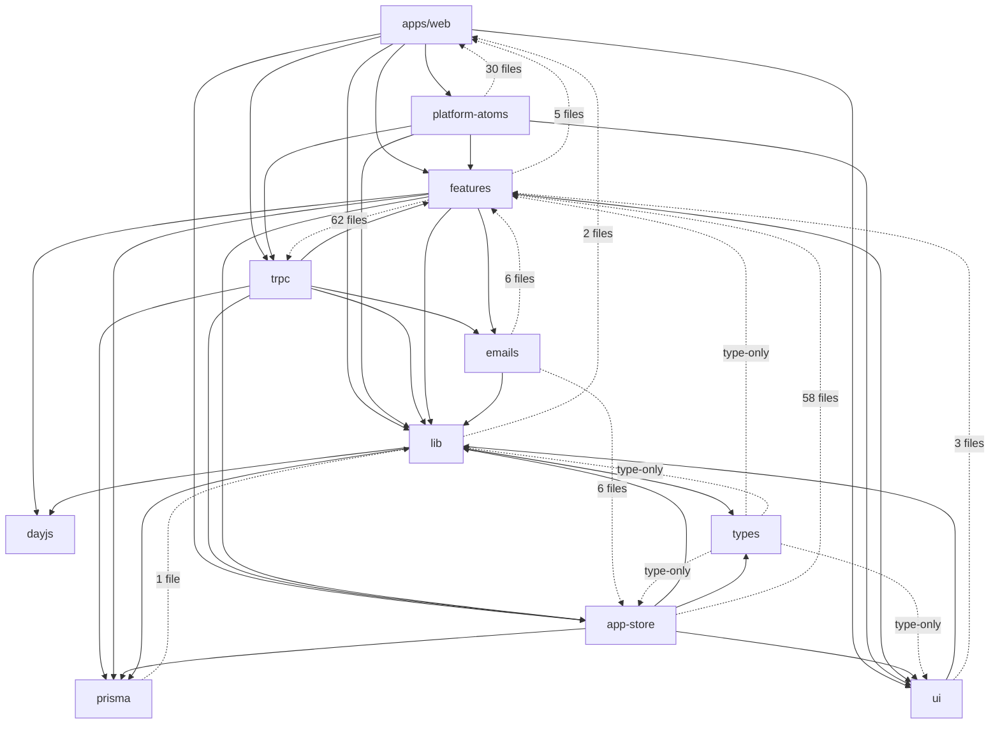

# Cal.com monorepo — dependency analysis

Scope: every workspace package under `packages/` (with `packages/platform/*` and `packages/embeds/*` split into their own nodes, `packages/features/ee` and `packages/features/auth` folded into `features`, all `packages/app-store/*` apps folded into `app-store`) and the apps `apps/web`, `apps/api/v1`, `apps/api/v2`.

## 1. Method

- Static scan of every `.ts/.tsx/.js/.jsx/.mjs/.cjs` file (excluding `node_modules`, `dist`, `.next`, `build`).
- Captured `import … from`, `export … from`, dynamic `import()`, `require()` and `vi.mock()` specifiers; specifiers inside template literals (e.g. generated embed snippets) are ignored.
- Specifiers were resolved through workspace package names (`@calcom/*`, `@coss/ui`), the `tsconfig` path aliases (`@lib/*`, `@components/*`, `~/*`, `@calcom/repository/*`) and relative paths. Relative paths that leave their own package count as cross-package edges.
- Test-only files (`*.test.*`, `*.spec.*`, `*.e2e.*`, `__tests__`, `__mocks__`, `test-setup`, `playwright`, …) are excluded from all numbers below.
- Edge weight = number of distinct **files** in the source package importing the target. "Value" = files with at least one non-`import type` import. Type-only edges are erased at compile time but still couple packages for type-checking and build ordering.

Totals: 27 nodes and ~6,700 source files (tests included). Production files have ~23,000 imports that resolve to a workspace package. ~13,300 of those cross a package boundary, and they form 135 distinct package → package edges.

## 2. Dependency matrix (core packages)

Cell = files in *row* importing from *column*; `n (v)` when some are type-only (`v` = value-import files). Empty = no imports.

| from \ to | apps/web | platform-atoms | platform-libraries | trpc | features | app-store | emails | sms | ui | lib | types | prisma | dayjs | embed-core |
|---|---|---|---|---|---|---|---|---|---|---|---|---|---|---|
| **apps/web** | · | 37 |  | 363 (340) | 560 (520) | 85 (80) | 5 |  | 569 (566) | 701 | 67 (0) | 233 (198) | 73 (67) | 18 |
| **platform-atoms** | 30 (28) | · | 2 (0) | 16 (11) | 45 (28) | 8 (7) |  |  | 25 (23) | 34 (33) | 8 (0) | 15 (5) | 5 | 1 |
| **platform-libraries** |  |  | · | 8 | 12 | 3 (2) | 1 |  |  | 6 | 2 (0) | 3 (2) |  |  |
| **trpc** |  |  |  | · | 275 (271) | 46 | 12 |  | 1 | 138 | 9 (0) | 276 (242) | 14 |  |
| **features** | 5 (3) | 7 (6) |  | 62 (44) | · | 103 (81) | 33 |  | 52 (51) | 358 (342) | 101 (4) | 434 (325) | 103 (102) | 5 |
| **app-store** |  | 1 |  |  | 58 (56) | · | 5 |  | 51 (49) | 230 (226) | 154 (0) | 151 (134) | 10 |  |
| **emails** |  |  |  |  | 3 | 3 | · | 1 |  | 86 | 37 (0) | 10 (7) | 5 |  |
| **sms** |  |  |  |  | 1 |  |  | · |  | 8 | 10 (0) | 1 | 1 |  |
| **ui** |  |  |  |  | 3 |  |  |  | · | 36 | 3 (0) | 3 (0) | 1 | 1 |
| **lib** | 2 | 1 |  |  | 2 (1) |  | 1 (0) |  |  | · | 21 (0) | 44 (27) | 19 (18) | 4 |
| **types** |  |  |  |  | 1 (0) | 2 (0) |  |  | 1 (0) | 1 (0) | · | 10 (1) |  |  |
| **prisma** |  |  |  |  |  |  |  |  |  | 1 |  | · |  |  |
| **dayjs** |  |  |  |  |  |  |  |  |  |  |  |  | · |  |
| **embed-core** |  |  |  |  |  |  |  |  |  |  |  |  |  | · |

Leaf packages not shown: `config`, `kysely`, `platform-constants` and `dayjs` have no workspace dependencies; `embed-core` has none either.

Dotted arrows are the back-edges listed in §3.

## 3. Circular dependencies

### 3.1 Package-level strongly connected components

| SCC | Members | Notes |
|---|---|---|
| **Main cycle** | apps/web, platform-atoms, platform-libraries, trpc, features, app-store, emails, sms, ui, lib, types, prisma (12) | 11 of them stay in one SCC even when type-only imports are ignored. Every core package can reach every other one, so no package can be built, tested or published in isolation. |
| ~~platform-enums ↔ platform-types~~ | platform-enums, platform-types | **Fixed in this PR** (see §6). |

### 3.2 Back-edges that close the cycle

Target layering used to classify edges (lower may never import higher):
`L0 prisma, types, dayjs, config, kysely, platform-constants/enums, embed-core` → `L1 lib, platform-types/utils` → `L2 ui, emails, sms` → `L3 features, app-store` → `L4 trpc` → `L5 platform-atoms, platform-libraries` → `L6 apps/*`.

Each row is an import going *up* the stack (or the minority direction between two same-layer packages). Sorted from smallest to biggest, so the top rows are the cheapest to remove.

| Back-edge (from → to) | Files | Value-import files | Example file |
|---|---|---|---|
| lib → apps/web | 2 | 2 | `packages/lib/hooks/useLocale.ts` |
| lib → platform-atoms | 1 | 1 | `packages/lib/hooks/useLocale.ts` |
| types → features | 1 | 0 | `packages/types/Calendar.d.ts` |
| types → app-store | 2 | 0 | `packages/types/App.d.ts` |
| features → apps/web | 5 | 3 | `packages/features/auth/signup/handlers/calcomHandler.ts` |
| app-store → platform-atoms | 1 | 1 | `packages/app-store/_components/AppCard.tsx` |
| types → ui | 1 | 0 | `packages/types/data-table.d.ts` |
| lib → features | 2 | 1 | `packages/lib/domainManager/organization.ts` |
| features → platform-atoms | 7 | 6 | `packages/features/bookings/Booker/components/hooks/useBookings.ts` |
| lib → emails | 1 | 0 | `packages/lib/formbricks.ts` |
| prisma → lib | 1 | 1 | `packages/prisma/zod-utils.ts` |
| sms → features | 1 | 1 | `packages/sms/sms-manager.ts` |
| types → lib | 1 | 0 | `packages/types/Calendar.d.ts` |
| emails → features | 3 | 3 | `packages/emails/email-manager.ts` |
| emails → app-store | 3 | 3 | `packages/emails/src/components/LocationInfo.tsx` |
| ui → features | 3 | 3 | `packages/ui/components/avatar/UserAvatarGroup.tsx` |
| platform-atoms → apps/web | 30 | 28 | `packages/platform/atoms/add-members-switch/AddMembersWithSwitchPlatformWrapper.tsx` |
| features → trpc | 62 | 44 | `packages/features/Segment.tsx` |
| app-store → features | 58 | 56 | `packages/app-store/_appRegistry.ts` |

Notable details:

- **Packages importing the app (`@calcom/web`)**: `lib/hooks/useLocale.ts` (`AppRouterI18nProvider`, `CustomI18nProvider`), `lib/server/i18n.ts` (relative `../../../apps/web/public/static/locales/en/common.json`), `features/auth/signup/handlers/calcomHandler.ts` (`buildLegacyCtx`), `features/calendars/weeklyview/index.tsx`, `features/ee/event-tracking/lib/posthog/provider.tsx` (`GeoContext`), and type-only `features/users/lib/UserListTableUtils.ts` and `features/pbac/lib/team-member-permissions.ts` (`UserTable/types`). `packages/app-store/tsconfig.json` also aliases `@lib/*` and `@components/*` to `apps/web`.
- **platform-atoms → apps/web (30 files)**: 49 imports target `apps/web/modules/event-types/components`, 14 `apps/web/public/static/locales`, 8 `modules/bookings/components`, 6 `modules/apps/components`. Atoms are a publishable SDK but cannot be built without the Next.js app.
- **`useIsPlatform` pulls atoms downward**: 32 files outside atoms (in features, ui, app-store, lib) import `@calcom/atoms/hooks/useIsPlatform`, which is just `Boolean(useAtomsContext()?.clientId)`.
- **features ↔ trpc (275 vs 62 files)**: features imports `@calcom/trpc/react` in 42 files (client hooks inside feature components) and a few router handler/schema files (`trpc/viewer/slots`, `viewer/teams`, …).
- **app-store ↔ features (58 vs 103 files)**: app-store uses `features/webhooks`, `credentials`, `auth`, `ee/api-keys`; features uses the app-store registry (`app-store/(root)` 59 files), `routing-forms` (28) and `_utils` (19).
- **emails ↔ features / app-store**: `email-manager.ts` reads `OrganizationSettingsRepository` and `eventNaming`; `templates/_base-email.ts` and `organizer-request-email.ts` call feature flags; `LocationInfo.tsx` imports `@calcom/app-store/locations`.
- **prisma → lib**: `packages/prisma/zod-utils.ts` re-exports `eventTypeLocations` / `eventTypeSlug` from `@calcom/lib/zod/eventType`. `schema.prisma` `@zod.import` directives reference those names through `zod-utils`, so the re-export can't just be deleted.
- **types → features / app-store / ui / lib (type-only)**: `types/Calendar.d.ts`, `App.d.ts`, `VideoApiAdapter.d.ts`, `data-table.d.ts` reference implementation packages. A "types" package should be a leaf.

### 3.3 Cycles inside `packages/features`

At sub-module level (`features/<dir>`, `features/ee/<dir>`) 41 of 72 modules form one SCC, with 56 mutual pairs. Largest:

| Pair | Files A→B | Files B→A |
|---|---|---|
| bookings ↔ di | 26 | 13 |
| bookings ↔ ee/workflows | 14 | 7 |
| booking-audit ↔ di | 14 | 2 |
| bookings ↔ webhooks | 10 | 1 |
| bookings ↔ tasker | 1 | 8 |
| ee/billing ↔ ee/workflows | 1 | 8 |
| bookings ↔ eventtypes | 6 | 3 |
| bookings ↔ form-builder | 7 | 1 |
| di ↔ watchlist | 3 | 5 |
| ee/workflows ↔ tasker | 2 | 5 |

`features/di` (the IoC container modules) is imported by and imports from feature modules, so the composition root lives in the same layer as the code it wires.

## 4. Fan-out (efferent coupling)

Ce = distinct workspace packages imported, Ca = distinct packages importing it, Instability = Ce/(Ca+Ce) (0 = stable foundation, 1 = leaf consumer).

| Package | Prod files | Fan-out (Ce) | Fan-in (Ca) | Instability | Files with cross-pkg imports |
|---|---|---|---|---|---|
| apps/web | 1270 | 15 | 3 | 0.83 | 1040 (82%) |
| features | 1006 | 14 | 12 | 0.54 | 645 (64%) |
| platform-atoms | 178 | 13 | 5 | 0.72 | 132 (74%) |
| apps/api/v2 | 830 | 10 | 0 | 1.00 | 546 (66%) |
| trpc | 692 | 10 | 6 | 0.62 | 411 (59%) |
| lib | 244 | 9 | 13 | 0.41 | 74 (30%) |
| app-store | 848 | 8 | 8 | 0.50 | 405 (48%) |
| apps/api/v1 | 202 | 8 | 0 | 1.00 | 173 (86%) |
| platform-libraries | 18 | 8 | 2 | 0.80 | 14 (78%) |
| emails | 136 | 7 | 6 | 0.54 | 95 (70%) |
| ui | 176 | 6 | 7 | 0.46 | 38 (22%) |
| sms | 10 | 5 | 1 | 0.83 | 10 (100%) |
| types | 30 | 5 | 13 | 0.28 | 11 (37%) |
| platform-examples | 25 | 4 | 0 | 1.00 | 14 (56%) |
| ee | 2 | 2 | 0 | 1.00 | 2 (100%) |
| embed-react | 8 | 2 | 0 | 1.00 | 3 (38%) |
| embed-snippet | 3 | 2 | 1 | 0.67 | 1 (33%) |
| platform-types | 121 | 2 | 5 | 0.29 | 24 (20%) |
| platform-utils | 3 | 2 | 2 | 0.50 | 1 (33%) |
| app-store-cli | 21 | 1 | 0 | 1.00 | 2 (10%) |
| prisma | 20 | 1 | 14 | 0.07 | 1 (5%) |
| config | 4 | 0 | 7 | 0.00 | 0 (0%) |
| dayjs | 3 | 0 | 11 | 0.00 | 0 (0%) |
| embed-core | 34 | 0 | 7 | 0.00 | 0 (0%) |
| kysely | 2 | 0 | 3 | 0.00 | 0 (0%) |
| platform-constants | 4 | 0 | 6 | 0.00 | 0 (0%) |
| platform-enums | 12 | 0 | 2 | 0.00 | 0 (0%) |

Excessive fan-out:

| Package | Why it's a problem |
|---|---|
| **features** (Ce 15, Ca 12) | Both highly depended on *and* depends on almost everything, including `apps/web`, `trpc`, `platform-atoms` and `emails`. It's the hub of the main cycle. Internally `features/bookings` imports 32 sibling modules and `features/di` 27. |
| **platform-atoms** (Ce 13) | A published SDK that imports 13 internal packages, including `apps/web` and `platform-libraries`. None of the 13 are declared in its `package.json`. |
| **trpc** (Ce 10) | Expected for an API layer, but it also imports `ui` and `app-store` internals, and `features/pbac` alone accounts for 69 importing files. |
| **lib** (Ce 9, Ca 13) | The "shared utilities" foundation imports `apps/web`, `features`, `platform-atoms`, `emails`, `embed-core`. It should be close to Ce 3 (prisma, dayjs, types). |
| **sms** (Ce 5, 100% of files cross-package) | `sms-manager.ts` reaches into `features/ee/billing` and `features/ee/workflows`. |

## 5. Tightly coupled clusters (interface-boundary candidates)

1. **features ⇄ trpc ⇄ apps/web**: business logic, tRPC routers and React UI are interleaved. features holds both server services and client components that call `trpc/react`. There's no stable contract between "domain service" and "transport".
2. **apps/web ⇄ platform-atoms ⇄ features**: event-type, booking and availability UI is split across the three, with atoms importing web modules and features importing atoms hooks.
3. **app-store ⇄ features ⇄ emails**: the app registry, credentials, webhooks and email templates refer to each other in both directions.
4. **lib ⇄ prisma ⇄ types**: the base packages refer to each other (prisma→lib zod schemas, types→lib/features/app-store type references, lib→prisma 44 files).
5. **features internal**: bookings, di, ee/workflows, tasker, webhooks and booking-audit form a tight core with bidirectional imports.

Undeclared workspace dependencies are widespread. Imports that resolve only because of hoisting in Yarn workspaces include: `trpc` (10 undeclared), `features` (10), `platform-atoms` (13), `lib` (6), `types` (5), `ui` (5), `emails` (4), `prisma` (1). Turbo's task graph is derived from `package.json`, so build/type-check ordering can't be trusted.

## 6. Quick win implemented in this PR

**Break the `platform-enums ↔ platform-types` cycle.**

- `platform-types` imports `@calcom/platform-enums` (8 files, value imports).
- `platform-enums/permissions.ts` imported `type PLATFORM_PERMISSION` back from `@calcom/platform-types`. `platform-enums/package.json` doesn't declare that dependency (it only declares `platform-constants`).
- That file was an exact duplicate of `packages/platform/utils/permissions.ts`. Nothing exported it (it isn't in `index.ts` or `monorepo.ts`) and nothing imported it. It has been deleted; `@calcom/platform-utils` keeps the live copy.
- Result: `platform-enums` depends only on `platform-constants`, the SCC is gone, and the package's dependencies match its `package.json`. Nothing imported the file, so there's no runtime change.

## 7. Prioritised refactoring recommendations

| # | Recommendation | Breaks | Effort | Impact |
|---|---|---|---|---|
| 1 | Move `MemberPermissions` → `features/pbac` and `UserTableUser` → `features/users` (types), keep `apps/web/.../UserTable/types.ts` re-exporting. Move `GeoContext`, `buildLegacyCtx` and the weekly-view `Calendar` into features (or inject them). | features → apps/web (5 files) | S | High: packages stop depending on the app |
| 2 | Move `useIsPlatform` / `AtomsContext` into a small leaf module (e.g. `@calcom/lib/hooks/useIsPlatform` backed by a context in `lib`) and have atoms provide it. Drop the `@calcom/web` i18n provider imports from `lib/hooks/useLocale.ts` (inject via context). | lib/ui/features/app-store → platform-atoms (32 files), lib → apps/web | S–M | High: removes the SDK from the base layers |
| 3 | Make `packages/types` a leaf: move the referenced shapes (`intervalLimitSchema` type, `getBookingResponsesSchema` output, `dailyvideo/zod`, `icon-names`, `app-store/types`) into `types`, or move those `.d.ts` files next to their implementations. | types → lib/features/app-store/ui | S | Medium |
| 4 | `emails`: pass organisation settings, feature-flag results and event names in as template inputs instead of looking them up inside `email-manager.ts` / `_base-email.ts`. Move the `routing-forms` email templates and `LocationInfo`'s location lookup behind an `emails`-owned interface. | emails → features/app-store, sms → features | M | Medium |
| 5 | `prisma → lib`: move `slugify` + `lib/zod/eventType.ts` into a dependency-free package (or into `prisma/zod`), and point `@calcom/lib/zod/eventType` at it. That keeps the `schema.prisma` `@zod.import` paths working. | prisma → lib | S | Medium: makes the DB package a true leaf |
| 6 | platform-atoms: move the 30 imported `apps/web/modules/{event-types,bookings,apps}/components` into `features` (or atoms), and load locales via the package rather than `apps/web/public`. | platform-atoms → apps/web | M–L | High for SDK publishing |
| 7 | Split `features` into server and client entry points. Server services (repositories, services, di) must not import `trpc/react` or `ui`. Client components that call `trpc/react` move to `apps/web/modules` or a `features/*/client` boundary. Move `features/di` composition to the app/api layer. | features ↔ trpc, features internal SCC | L | Very high: the main cycle hub |
| 8 | Declare every workspace dependency in each `package.json`, then add an automated boundary check to CI (e.g. `dependency-cruiser` or Biome `noRestrictedImports` rules encoding the §3.2 layering) so new back-edges fail fast. | prevents regressions | S | High |

Suggested order: 8 (guard rails) → 1, 2, 3 (cheap back-edges) → 5, 4 → 6 → 7.
