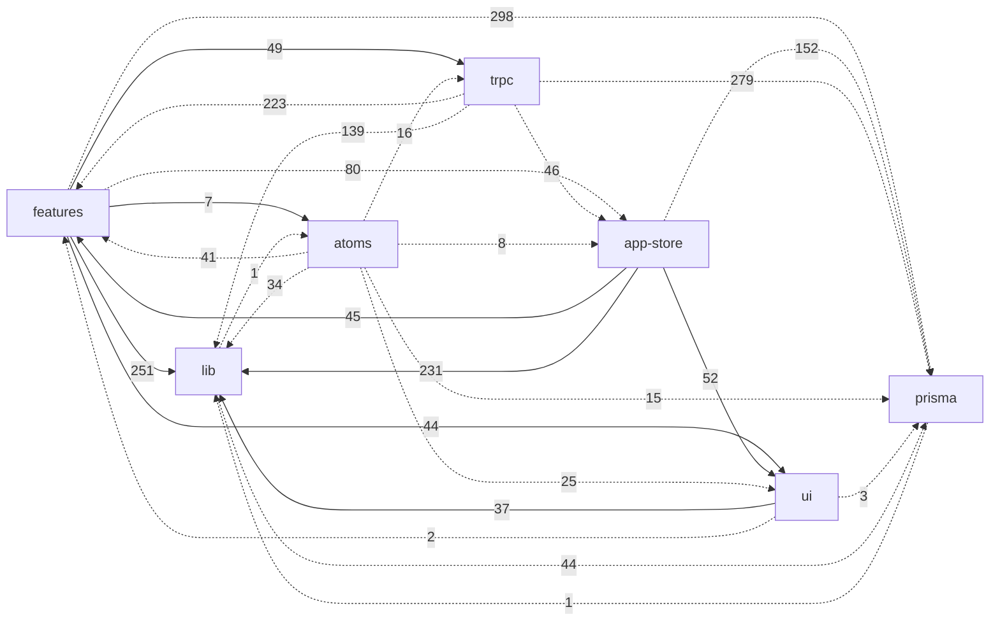

# Package Dependency Analysis: `packages/*` and `apps/web`

Snapshot of the workspace dependency graph at commit `f85d2dd` (2026-09-03). It covers the core packages under `packages/*` and how they relate to `apps/web` (`@calcom/web`).

## 1. Methodology

Edges come from two sources and are compared:

- **(a) Declared edges.** Each package's `package.json` was parsed for `@calcom/*` (and `@coss/ui`) entries in `dependencies`, `devDependencies` and `peerDependencies`. All of them use `workspace:*`.
- **(b) Import edges.** Every tracked `.ts/.tsx/.js/.jsx/.mjs/.cjs` file under `apps/web` and `packages/` was scanned for `import … from "@calcom/…"`, `export … from "@calcom/…"`, side-effect `import "@calcom/…"`, dynamic `import("@calcom/…")`, `require("@calcom/…")` and `vi.mock("@calcom/…")`.

Resolution rules:

- A file belongs to the nearest ancestor directory that has a `package.json` with a `name`.
- An import specifier is resolved to a physical path first, then to the package that owns that path. So `@calcom/features/auth/...` resolves to `@calcom/feature-auth` (`packages/features/auth`), and `@calcom/features/ee/...` resolves to `@calcom/ee` (`packages/features/ee`), even though both are reached through the `@calcom/features` alias.
- The ~100 app sub-packages under `packages/app-store/*` (for example `dailyvideo`, `zoomvideo`, `routing-forms`) are folded into `@calcom/app-store`. They are only broken out in the manifest-level fan-in count in §5.
- Files matching `.test.`, `.spec.`, `.e2e.`, `/test/`, `/tests/`, `__tests__`, `__mocks__` are counted as **test** imports. "Prod" counts exclude them.
- Counts are **number of distinct files** that import the target package, not number of import statements.

A discrepancy is any edge that appears in (a) but not (b), or in (b) but not (a).

## 2. Declared workspace edges (`package.json`)

| Package | Declared `workspace:*` deps |
|---|---|
| `@calcom/web` (`apps/web`) | app-store, app-store-cli, dayjs, embed-core, embed-react, embed-snippet, features, lib, platform-enums, platform-types, prisma, trpc, tsconfig, ui, `@coss/ui` (15 runtime) + config, types (dev) |
| `@calcom/features` | atoms, dayjs, lib, trpc, ui |
| `@calcom/app-store` | dailyvideo, dayjs, features, lib, office365video, ui, zoomvideo (+ types dev) |
| `@calcom/ui` | lib (+ config, tsconfig dev) |
| `@calcom/lib` | config, dayjs (+ tsconfig, types dev) |
| `@calcom/emails` | dayjs, lib (+ tsconfig, types dev) |
| `@calcom/feature-auth` | dayjs, lib, prisma, trpc, ui |
| `@calcom/ee` | lib, ui (+ tsconfig dev) |
| `@calcom/platform-libraries` | features, lib |
| `@calcom/platform-utils` | platform-constants, platform-types |
| `@calcom/platform-types` | platform-constants, platform-enums |
| `@calcom/platform-enums` | platform-constants |
| `@calcom/embed-react` | embed-core, embed-snippet |
| `@calcom/embed-snippet` | embed-core |
| `@calcom/trpc`, `@calcom/atoms`, `@calcom/prisma`, `@calcom/types`, `@calcom/config`, `@calcom/dayjs`, `@calcom/platform-constants`, `@calcom/embed-core`, `@coss/ui` | *(none)* |

`@calcom/trpc` and `@calcom/atoms` declare **no** workspace dependencies, but they are among the heaviest importers in the repo (see §3).

## 3. Dependency matrix

Rows are importers and columns are imported packages. The number is the count of distinct importing files (prod + test).

| Symbol | Meaning |
|---|---|
| ● n | Declared in `package.json` **and** imported in source |
| ○ | Declared but **not** imported in any scanned source file |
| ◆ n | Imported (in at least one prod file) but **not declared** |
| ◇ n | Imported only from test files, not declared |

| importer ↓ / imported → | web | app-store | features | feature-auth | ee | trpc | ui | lib | prisma | emails | dayjs | types | config | atoms | platform-libraries | platform-types | platform-utils | platform-constants | platform-enums | embed-core | embed-react | embed-snippet | coss-ui |
|---|---|---|---|---|---|---|---|---|---|---|---|---|---|---|---|---|---|---|---|---|---|---|---|
| **web** | — | ● 94 | ● 466 | ◆ 126 | ◆ 155 | ● 381 | ● 574 | ● 767 | ● 322 | ◆ 8 | ● 89 | ● 74 | ● 1 | ◆ 36 |  | ● 11 |  | ◆ 12 | ○ | ● 20 | ○ | ○ | ○ |
| **app-store** | ◇ 7 | — | ● 50 | ◆ 10 | ◆ 14 |  | ● 53 | ● 247 | ◆ 164 | ◆ 5 | ● 12 | ● 163 |  | ◆ 2 |  |  |  |  |  |  |  |  |  |
| **features** | ◆ 35 | ◆ 106 | — | ◆ 6 | ◆ 61 | ● 55 | ● 44 | ● 302 | ◆ 411 | ◆ 20 | ● 104 | ◆ 95 |  | ● 7 |  | ◆ 2 |  |  |  | ◆ 6 | ◆ 1 |  |  |
| **feature-auth** | ◆ 2 | ◆ 3 | ◆ 13 | — | ◆ 6 | ● 2 | ● 2 | ● 24 | ● 26 | ◆ 2 | ● 4 | ◆ 2 | ◆ 2 |  |  |  |  |  |  |  |  |  |  |
| **ee** | ◆ 7 | ◆ 25 | ◆ 65 | ◆ 10 | — | ◆ 17 | ● 6 | ● 91 | ◆ 136 | ◆ 18 | ◆ 25 | ◆ 15 |  |  |  |  |  |  |  |  |  |  |  |
| **trpc** |  | ◆ 51 | ◆ 251 | ◆ 20 | ◆ 92 | — | ◆ 1 | ◆ 155 | ◆ 316 | ◆ 15 | ◆ 14 | ◆ 11 | ◆ 1 |  |  |  |  |  |  |  |  |  |  |
| **ui** |  |  | ◆ 2 |  | ◆ 3 |  | — | ● 43 | ◆ 3 |  | ◆ 1 | ◆ 4 | ○ | ◆ 1 |  |  |  |  |  | ◆ 1 |  |  |  |
| **lib** | ◆ 1 | ◇ 1 | ◇ 2 |  | ◆ 2 |  |  | — | ◆ 49 | ◆ 2 | ● 23 | ● 24 | ● 2 | ◆ 1 |  |  |  |  |  | ◆ 4 |  |  |  |
| **prisma** |  |  |  |  |  |  |  | ◆ 1 | — |  |  |  |  |  |  |  |  |  |  |  |  |  |  |
| **emails** | ◇ 2 | ◆ 3 | ◆ 4 |  |  |  |  | ● 88 | ◆ 11 | — | ● 5 | ● 38 |  |  |  |  |  |  |  |  |  |  |  |
| **dayjs** |  |  |  |  |  |  |  |  |  |  | — |  |  |  |  |  |  |  |  |  |  |  |  |
| **types** |  | ◆ 2 | ◆ 1 |  |  |  | ◆ 1 | ◆ 1 | ◆ 10 |  |  | — |  |  |  |  |  |  |  |  |  |  |  |
| **config** |  |  |  |  |  |  |  |  |  |  |  |  | — |  |  |  |  |  |  |  |  |  |  |
| **atoms** | ◆ 30 | ◆ 8 | ◆ 41 |  | ◆ 8 | ◆ 16 | ◆ 26 | ◆ 35 | ◆ 15 |  | ◆ 5 | ◆ 8 |  | — | ◆ 2 | ◆ 72 |  | ◆ 73 |  | ◆ 1 |  |  |  |
| **platform-libraries** |  | ◆ 3 | ● 10 | ◆ 2 | ◆ 5 | ◆ 8 |  | ● 6 | ◆ 3 | ◆ 1 |  | ◆ 2 | ◆ 1 |  | — |  |  |  |  |  |  |  |  |
| **platform-types** |  |  |  |  |  |  |  |  |  |  |  |  |  |  |  | — |  | ● 16 | ● 8 |  |  |  |  |
| **platform-utils** |  |  |  |  |  |  |  |  |  |  |  |  |  |  |  | ● 1 | — | ● 2 |  |  |  |  |  |
| **platform-constants** |  |  |  |  |  |  |  |  |  |  |  |  |  |  |  |  |  | — |  |  |  |  |  |
| **platform-enums** |  |  |  |  |  |  |  |  |  |  |  |  |  |  |  | ◆ 1 |  | ● 1 | — |  |  |  |  |
| **embed-core** | ◇ 6 |  |  |  |  |  |  | ◇ 1 | ◇ 2 |  |  |  |  |  |  |  |  |  |  | — |  |  |  |
| **embed-react** | ◇ 1 |  |  |  |  |  |  |  |  |  |  |  |  |  |  |  |  |  |  | ● 3 | — | ● 2 |  |
| **embed-snippet** |  |  |  |  |  |  |  |  |  |  |  | ◆ 1 |  |  |  |  |  |  |  | ● 1 |  | — |  |
| **coss-ui** |  |  |  |  |  |  |  |  |  |  |  |  |  |  |  |  |  |  |  |  |  |  | — |

### 3.1 Declared vs. import discrepancies

**Declared but not imported (○)**

- `web → @coss/ui`: only referenced from `apps/web/components.json` and `apps/web/tsconfig.json`. No `.ts/.tsx` file in `apps/web` imports it.
- `web → platform-enums`, `web → embed-react`, `web → embed-snippet`: no source imports from `apps/web`.
- `ui → config` (dev): no source imports. It is likely used only by Tailwind/tooling config.
- `app-store-cli` and `tsconfig` (declared by web) are tooling packages and are not in the matrix.

**Imported but not declared (◆), largest first**

| Edge | Prod files | Test files |
|---|---|---|
| web → features (`@calcom/features/ee/*` → ee) | 142 | 13 |
| web → feature-auth | 120 | 6 |
| trpc → prisma | 279 | 37 |
| trpc → features | 223 | 28 |
| trpc → lib | 139 | 16 |
| features → prisma | 298 | 113 |
| features → app-store | 80 | 26 |
| app-store → prisma | 152 | 12 |
| ee → prisma | 111 | 25 |
| atoms → platform-constants / platform-types | 73 / 72 | 0 |
| lib → prisma | 44 | 5 |
| atoms → features | 41 | 0 |
| atoms → web | 30 | 0 |

In practice every package resolves the others through Yarn workspace hoisting and the root TypeScript path setup. As a result, undeclared edges are invisible to Turbo's task graph and to `yarn why`.

## 4. Circular dependencies

All prod import edges were run through Tarjan's strongly-connected-components algorithm. The result is **one SCC of 16 packages**: `web, features, feature-auth, ee, billing, app-store, trpc, lib, prisma, ui, atoms, emails, types, platform-libraries, embed-react, embed-snippet`. There is also a small `platform-enums ↔ platform-types` cycle.

The SCC contains 30 direct two-package cycles. The three most important are below.

### 4.1 `features` ↔ `app-store` (80 prod files → / 45 prod files ←)

- **features → app-store** (undeclared in `packages/features/package.json`):
  - `packages/features/bookings/lib/EventManager.ts` imports `@calcom/app-store/_utils/getCalendar`, `@calcom/app-store/dailyvideo/lib/VideoApiAdapter`, `@calcom/app-store/dailyvideo/zod`.
  - `packages/features/routing-forms/lib/getRoutedUrl.ts` imports `@calcom/app-store/routing-forms/enrichFormWithMigrationData`, `.../getEventTypeRedirectUrl`, `.../lib/getResponseToStore`.
- **app-store → features** (declared in `packages/app-store/package.json`):
  - `packages/app-store/_utils/payments/handlePaymentSuccess.ts` imports `@calcom/features/bookings/lib/EventManager`, `.../doesBookingRequireConfirmation`, `.../getAllCredentials`.
  - `packages/app-store/delegationCredential.ts` imports `@calcom/features/credentials/repositories/CredentialRepository` and `@calcom/features/delegation-credentials/repositories/DelegationCredentialRepository`.

This produces a tight loop: `EventManager` (features) calls app-store calendar/video adapters, and app-store's payment handler calls back into `EventManager`.

### 4.2 `features` ↔ `trpc` (49 prod files → / 223 prod files ←)

- **features → trpc** (declared):
  - Booker hooks: `packages/features/bookings/Booker/components/hooks/useAvailableTimeSlots.ts`, `useBookings.ts`, `useCalendars.ts`, `useSlots.ts`, `useVerifyCode.ts`, `useVerifyEmail.ts`, plus `packages/features/bookings/Booker/utils/event.ts`.
  - `packages/features/di/modules/AvailableSlots.ts` imports `AvailableSlotsService` from `@calcom/trpc/server/routers/viewer/slots/util`. Here the DI container in features depends on a service implementation that lives in trpc.
  - `packages/features/flags/server/router.ts` imports `@calcom/trpc/server/procedures/publicProcedure` and `@calcom/trpc/server/trpc`. This is a tRPC router defined inside features.
- **trpc → features** (undeclared, since `packages/trpc/package.json` declares nothing): 223 prod files. For example, `packages/trpc/server/routers/viewer/slots/util.ts` imports `@calcom/features/availability/lib/getAggregatedAvailability/...`, `@calcom/features/availability/lib/getUserAvailability`, `@calcom/features/bookings/lib/checkBookingLimits` and more.

`biome.json` already has a `noRestrictedImports` rule for `packages/features/**` that bans `../trpc/**`. It only matches **relative** paths, so the `@calcom/trpc/...` alias imports above pass lint.

### 4.3 `features` ↔ `atoms` (7 prod files → / 41 prod files ←)

- **features → atoms** (declared in `packages/features/package.json`): for example `packages/features/bookings/Booker/components/hooks/useBookings.ts`, `packages/features/components/phone-input/PhoneInput.tsx`, `packages/features/embed/lib/EmbedCodes.tsx`.
- **atoms → features** (undeclared): platform wrappers such as `packages/platform/atoms/booker/BookerPlatformWrapper.tsx`, `packages/platform/atoms/booker/BookerWebWrapper.tsx`, `packages/platform/atoms/availability/wrappers/AvailabilitySettingsPlatformWrapper.tsx`, `packages/platform/atoms/list-schedules/wrappers/ListSchedulesPlatformWrapper.tsx`.

### 4.4 Other notable cycles (outside the requested three)

| Cycle | Example back-edge file |
|---|---|
| `features` ↔ `ee` (50 / 56 prod) | `packages/features/bookings/lib/BookingEmailSmsHandler.ts` → `@calcom/features/ee/*` |
| `trpc` ↔ `ee` (83 / 11 prod) | ee → trpc in `packages/features/ee/**` routers |
| `lib` ↔ `web`, `lib` ↔ `atoms` | `packages/lib/hooks/useLocale.ts` imports `@calcom/web/app/AppRouterI18nProvider`, `@calcom/web/app/CustomI18nProvider`, `@calcom/atoms/hooks/useAtomsContext` |
| `lib` ↔ `ee` | `packages/lib/domainManager/organization.ts`, `packages/lib/formatCalendarEvent.ts` |
| `lib` ↔ `prisma` | `packages/prisma/zod-utils.ts` imports `@calcom/lib` |
| `ui` ↔ `features` | `packages/ui/components/calendar-switch/CalendarSwitch.tsx` |
| `web` ↔ `features` (4 prod files back) | `packages/features/calendars/weeklyview/index.tsx`, `packages/features/pbac/lib/team-member-permissions.ts` |
| `web` ↔ `atoms` (30 prod files back) | `packages/platform/atoms/booker/BookerPlatformWrapper.tsx` |
| `platform-enums` ↔ `platform-types` | `packages/platform/enums/permissions.ts` |

### 4.5 Core cycle cluster

Solid arrows are declared edges. Dashed arrows are import-only (undeclared). Labels are prod file counts.

### 4.6 Cycle summary

| Rank | Cycle | Prod files (→ / ←) | Blast radius | Recommended seam |
|---|---|---|---|---|
| 1 | features ↔ app-store | 80 / 45 | Booking creation, payments, calendar/video sync, routing forms | Shared contracts (app metadata, `Calendar`/`VideoApiAdapter`/payment service interfaces) in `@calcom/types` or a new `@calcom/app-store-types` leaf |
| 2 | features ↔ trpc | 49 / 223 | All viewer routers, Booker UI hooks, slot computation, DI container | Move `AvailableSlotsService` into features; move client hooks/types into a `@calcom/trpc-client` leaf; move `flags/server/router.ts` into trpc |
| 3 | features ↔ atoms | 7 / 41 | Platform SDK (atoms) and web Booker | Atoms depend on features only. Move `useAtomsContext`-style hooks that features needs into a small leaf |
| 4 | lib ↔ {web, atoms, ee, prisma} | 1–2 back-edges each | Every package (lib has the highest fan-in) | Move `useLocale` out of lib; split lib into server/shared (P3) |
| 5 | features ↔ ee, trpc ↔ ee | 50 / 56, 83 / 11 | Org/team, billing, workflows | Treat `features/ee` as part of features (merge manifests) or give it a one-way interface |
| 6 | ui ↔ features / ee / prisma | 2–3 files | Presentational layer pulls in server code | P4 |

## 5. Fan-out analysis

### 5.1 File-level (top offenders by `from "@calcom/*"` statements, non-test)

| File | `@calcom/*` import/re-export statements | Notes |
|---|---|---|
| `packages/features/bookings/lib/service/RegularBookingService.ts` | 67 (91 named bindings; 100 import statements total) | Core booking orchestration |
| `packages/platform/libraries/index.ts` | 56 (mix of `import` and multi-line `export { … } from`) | Barrel for the platform API |
| `apps/web/modules/bookings/views/bookings-single-view.tsx` | 44 | |
| `packages/trpc/server/routers/viewer/slots/util.ts` | 42 (40 unique specifiers) | Holds `AvailableSlotsService` |
| `apps/web/modules/event-types/views/event-types-listing-view.tsx` | 41 | |
| `packages/features/bookings/lib/handleCancelBooking.ts` | 36 | |
| `packages/trpc/server/routers/viewer/bookings/confirm.handler.ts` | 29 (28 unique specifiers) | |
| `packages/trpc/server/routers/viewer/teams/inviteMember/utils.ts` | 23 (20 unique specifiers) | |

### 5.2 Package-level

| Package | Declared workspace deps | Distinct workspace packages imported in source |
|---|---|---|
| `@calcom/web` | 15 runtime (+2 dev) | 17 |
| `@calcom/features` | 5 | 17 |
| `@calcom/atoms` | 0 | 14 |
| `@calcom/trpc` | 0 | 13 |
| `@calcom/app-store` | 7 (+1 dev) | 12 (excluding its own sub-packages) |

## 6. Fan-in / hub analysis

| Package | Importing files (prod + test) | Importing packages |
|---|---|---|
| `@calcom/lib` | 1,777 | 14 |
| `@calcom/prisma` | 1,488 | 14 |
| `@calcom/features` (incl. ee/auth paths resolved separately) | 919 | 12 |
| `@calcom/ui` | 708 | 9 |
| `@calcom/trpc` | 479 | 6 |
| `@calcom/app-store` | 297 | 11 |

### 6.1 `@calcom/prisma` is the critical hub

`lib` has slightly more importing files, but `@calcom/prisma` has the **widest blast radius** in the repo, for these reasons:

- **Declared** in `apps/web`, `apps/api/v1`, `apps/api/v2`, `packages/features/auth` and **26** app-store sub-package manifests:
  - applecalendar, caldavcalendar, closecom, dailyvideo
  - exchange2013calendar, exchange2016calendar, exchangecalendar
  - feishucalendar, giphy, googlecalendar, googlevideo, hitpay, hubspot, ics-feedcalendar, larkcalendar
  - office365calendar, office365video, salesforce, sendgrid, stripepayment, tandemvideo, vital
  - wipemycalother, zohocalendar, zohocrm, zoomvideo
- **Imported at source level** by 14 packages, mostly without a declaration:
  - features repositories: `packages/features/users/repositories/UserRepository.ts`, `packages/features/profile/repositories/ProfileRepository.ts`, `packages/features/ee/teams/repositories/TeamRepository.ts`
  - trpc handlers, for example `packages/trpc/server/routers/viewer/bookings/confirm.handler.ts` and `packages/trpc/server/createContext.ts`
  - lib repositories in `packages/lib/server/repository/*`, for example `selectedCalendar.ts`, `workspacePlatform.ts`, `PrismaRoutingFormResponseRepository.ts`
  - `packages/app-store/server.ts` (`prisma`, `Prisma`, `AppCategories`, `credentialForCalendarServiceSelect`)
  - `packages/platform/libraries/index.ts`, which re-exports `Prisma` types and `credentialForCalendarServiceSelect`
  - `packages/types/*.d.ts`, so even the "types" leaf depends on prisma
- **Build pipeline:** 12 of 42 tasks in `turbo.json` reference prisma. Seven are `@calcom/prisma#*` tasks (`build`, `db-migrate`, `db-seed`, `db-up`, `dx`, `post-install`, `db-reset`). The others (`@calcom/trpc#build`, `@calcom/web#dx`, `db-deploy`, `post-install`, `embed-tests-update-snapshots:ci`) depend on prisma tasks or use `schema.prisma` / migrations as inputs.
- **Generated client:** a schema change regenerates `@prisma/client` types that ~1,500 files compile against.

Refactoring `@calcom/prisma` (schema, generated enums, `selects/*`, `zod-utils`) therefore touches every app and nearly every package.

## 7. Undeclared dependency edges

| Edge | Evidence | Declared? |
|---|---|---|
| `lib → prisma` | 49 files (44 prod), e.g. `packages/lib/CalendarService.ts`, `packages/lib/availability.ts`, `packages/lib/server/repository/selectedCalendar.ts` | **No**: absent from `packages/lib/package.json` |
| `features → prisma` | 411 files (298 prod), e.g. `packages/features/users/repositories/UserRepository.ts`, `packages/features/apps/repository/PrismaAppRepository.ts` | **No**: absent from `packages/features/package.json` |
| `features → app-store` | 106 files (80 prod), e.g. `packages/features/bookings/lib/EventManager.ts` | **No** (the reverse edge `app-store → features` is declared) |
| `trpc → *` | 13 workspace packages imported, incl. prisma (316 files), features (251), lib (155) | **No**: `packages/trpc/package.json` declares no workspace deps |
| `atoms → *` | 14 workspace packages imported, incl. features, trpc, web, prisma | **No**: `packages/platform/atoms/package.json` declares no workspace deps |
| `app-store → prisma` | 164 files (core `packages/app-store` manifest; 26 sub-packages declare it themselves) | **No** in `packages/app-store/package.json` |
| `ui → prisma`, `ui → features`, `ui → ee` | `packages/ui/components/avatar/UserAvatar.tsx` (type-only `User`), `UserAvatarGroup.tsx`, `UserAvatarGroupWithOrg.tsx`, `calendar-switch/CalendarSwitch.tsx` | **No** |
| `types → prisma` | 10 `.d.ts` files, e.g. `packages/types/App.d.ts`, `packages/types/Calendar.d.ts` | **No** |

**Recommendation:** add a lint rule that every `@calcom/*` package imported by a workspace's source must appear in that workspace's `package.json`. Options are a dependency-cruiser rule, eslint `import/no-extraneous-dependencies` with `packageDir`, or a small CI script that reproduces the scan in §1. Without this rule, Turbo's `dependsOn: ["^build"]` graph is incomplete and cycles go unnoticed.

## 8. Coupling hotspots

- **`@calcom/lib` is a kitchen sink.** It mixes Prisma-backed repositories (`packages/lib/server/repository/*`), heavy server services (`packages/lib/CalendarService.ts`, `packages/lib/CloseCom.ts`), React hooks (`packages/lib/hooks/useLocale.ts`, which imports from `apps/web`) and client-safe helpers (constants, formatting). Because of this, lib has the highest fan-in (1,777 files) and a back-edge to almost every layer.
- **`ui → lib` pulls non-presentational code into the UI layer.** `ui` imports `@calcom/lib/hooks/useLocale` (30 files), `@calcom/lib/constants` (7), avatar helpers (`defaultAvatarImage` 4, `getAvatarUrl` 3, `checkIfItFallbackImage` 2), hooks (`useMediaQuery`, `useUrlMatchesCurrentUrl`, `useCompatSearchParams`) and `errors`. Through `useLocale`, `ui` transitively reaches `apps/web` and `atoms`. `ui` takes class-name merging from the npm `classnames` package, not from lib.
- **The `platform-libraries` barrel.** `packages/platform/libraries/index.ts` re-exports a wide surface across features, ee, trpc, app-store and prisma (`Prisma` types, `credentialForCalendarServiceSelect`) through 56 statements. Any consumer of the barrel depends on all of them.
- **app-store reaches into features internals.** app-store imports concrete modules such as `@calcom/features/bookings/lib/EventManager` and `@calcom/features/credentials/repositories/CredentialRepository` instead of a stable interface. Every internal refactor in features risks breaking ~100 app integrations.
- **Lint boundaries are path-based only.** The `noRestrictedImports` overrides in `biome.json` for lib, app-store, features and trpc ban `../features/**`, `../trpc/**` and similar relative paths, but not the `@calcom/*` aliases that the code actually uses.

## 9. Prioritized refactoring recommendations

| Priority | Recommendation | Cycles/edges removed |
|---|---|---|
| **P1** | Break `features ↔ app-store` by extracting shared contracts (app metadata types, `Calendar`/`VideoApiAdapter`/payment service interfaces, credential shapes) into `@calcom/types` or a new leaf `@calcom/app-store-types`. app-store implements the interfaces, and features consumes them through the registry and DI. | features → app-store (80 prod files) |
| **P2** | Break `features ↔ trpc`: (a) move `AvailableSlotsService` from `packages/trpc/server/routers/viewer/slots/util.ts` into features so that `packages/features/di/modules/AvailableSlots.ts` no longer reaches into trpc; (b) move `packages/features/flags/server/router.ts` into trpc; (c) move client-side tRPC hooks/types used by features (Booker hooks) into a leaf package such as `@calcom/trpc-client` that does not depend on features. | features → trpc (49 prod files) |
| **P3** | Split `@calcom/lib` into `lib-server` (Prisma repositories, `CalendarService`, CloseCom, etc.) and `lib-shared` (formatting, constants, pure helpers). Move `useLocale` out of lib so lib no longer imports `@calcom/web`/`@calcom/atoms`. Audit and **declare** the `@calcom/prisma` imports in lib, features, trpc, app-store core, ui and types. | lib ↔ web/atoms/ee/prisma; undeclared prisma edges |
| **P4** | Remove the `ui → lib` edge by moving the utilities that ui uses (`useLocale`, `constants`, `defaultAvatarImage`, `getAvatarUrl`, `checkIfItFallbackImage`, media/URL hooks) into ui-local modules or a small `lib-ui` leaf. Also replace the `@calcom/prisma/client` `User` type in `packages/ui/components/avatar/*` with a local prop type. | ui → lib/prisma/features/ee |
| **P5** | Replace the `packages/platform/libraries/index.ts` barrel with explicit per-domain entry points (some already exist, e.g. `packages/platform/libraries/app-store.ts`, `event-types.ts`). Forbid deep imports into features/prisma internals from platform consumers. | Barrel-wide coupling |
| **P6** | Reduce `RegularBookingService` fan-out (67 `@calcom/*` imports) using the existing DI container (`packages/features/di`, `packages/features/bookings/di/RegularBookingService.module.ts`). Inject repositories and services instead of importing concrete modules. | File-level fan-out |
| **P7** | Add tooling guardrails: dependency-cruiser (or eslint `import/no-cycle`) over the `@calcom/*` aliases, plus a workspace-boundary / undeclared-dependency rule (§7). Extend the existing `biome.json` `noRestrictedImports` patterns from relative paths to alias paths (e.g. `@calcom/trpc/**` in features, `@calcom/features/**` in app-store). Run it in CI with an allowlist of current violations that can only shrink. | Prevents regression |
